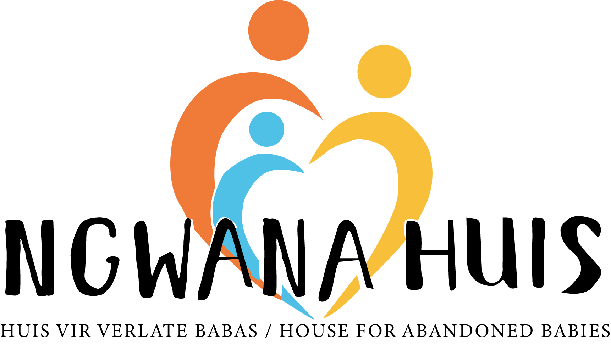
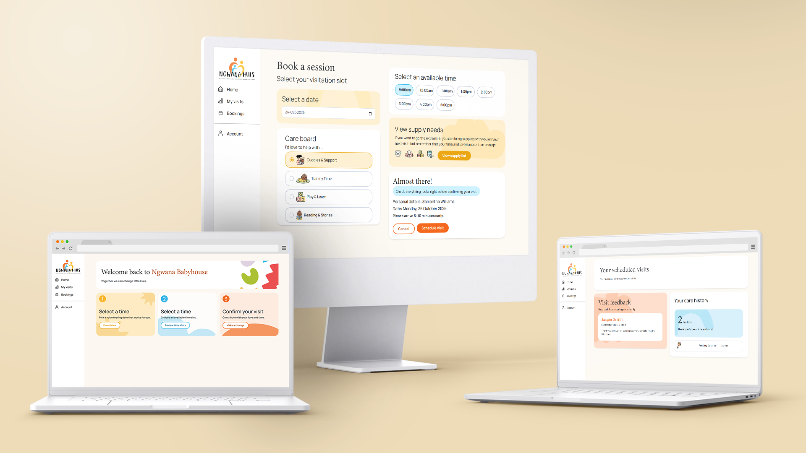

  
  
  
  

<!-- HEADER SECTION -->
<h5 align="center" style="padding:0;margin:0;">Joelene du Toit</h5>
<h5 align="center" style="padding:0;margin:0;">241161</h5>
<h6 align="center">DV 200</h6>

  

<h1 align="center">Ngwana Baby House</h1>

  Developing and deploying a web app designed by a UX team.

<!-- TABLE OF CONTENTS -->
## Table of Contents

- [About the Project](#about-the-project)
  - [Deployment links](#deployment-links)
  - [Project Description](#project-description)
  - [Built With](#built-with)
  - [Design reference](#design-reference)
- [Getting Started](#getting-started)
  - [Prerequisites](#prerequisites)
  - [How to install](#how-to-install)
- [Features and Functionality](#features-and-functionality)
- [Concept Process](#concept-process)
  - [Entity relationship diagram](#entity-relationship-diagram)
- [Deployment summary](#deployment-summary)
- [Mockups](#mockups)
- [Challenges and solutions](#challenges-and-solutions)

    

<!-- PROJECT DESCRIPTION -->
## About the Project
### Project Description

This web app is for an NGO, where volunteers can see real-time needs and volunteer to help, while staff can manage their volunteers and request supplies.

### Deployment links
* **Platform 1 (Azure):** [View Live Site](https://volunteerstudentproject-gqg4gyfdf6gtfsa5.southafricanorth-01.azurewebsites.net/)
* **Platform 2 (AWS):** [View Live Site](https://volunteerdashboardproject.duckdns.org)

### Built With

- [PHP](https://www.php.net/)
- [MySQL](https://www.mysql.com/)
- [MySQL Workbench](https://www.mysql.com/products/workbench/)
- [nginx](https://nginx.org/en/)
- [Bootstrap](https://getbootstrap.com/docs/5.3/getting-started/introduction/)

## Design reference

For this project, a UX design team completed the research and UX design. The design was then handed over to me to develop.

## Getting Started

The following instructions will get you a copy of the project up and running on your local machine for development and testing purposes.

### Prerequisites

Ensure that you have the latest version of [XAMPP](https://www.apachefriends.org/index.html) installed on your machine. Then download the repository and create a database using my entity relationship diagram.

### How to install

Clone the repository by running the following command in your terminal:

git clone [https://github.com/Joelene241161/Ngwana_Baby_House.git](https://github.com/Joelene241161/Ngwana_Baby_House.git)

<!-- FEATURES AND FUNCTIONALITY -->
## Features and Functionality

### Bookings

Volunteers can make a booking to volunteer at the NGO. They select the date and time and activity. 
Volunteers can view all of their bookings on the visits page, and decide to cancel them if they have to. They can also let the NGO know that they are going to be late. 
Staff can manage their booking schedule, where they can dictate the capacity of each time slot, and even decide to lock a time slot from all bookings. 
Staff can also select any day and see how many people have booked for certain times. 
Each day, staff can view all volunteers who made a booking and check them in and out.

### Supplies

Staff can make customised supply requests. While viewing the requests, they mark them as received or delete them. 
Volunteers can then view a list of the supply requests, so they know what to donate when they go for their next visit.

### Manage users

Staff can see all of the created accounts on their staff dashboard. Here they can assign volunteers staff roles, giving them access to the staff dashboard. They can also change the roles of their staff, as well as demoting them to volunteers.

### Messages

Staff can send messages with feedback to specific volunteers, then that volunteer can view those messages. Messages include information like who sent it and when.

### Reports

Staff can view the most recent volunteer activities, a total volunteer hours collected as well as their activities and their received donations (amount and type). 
They can also download the report page as a pdf, to save for later. 
Volunteers can view their care history, showing their activities and time spent volunteering.

### Account

Users have to make accounts to gain access. Everyone starts with them volunteer role. 
Users can upload and change account information, such as; phone number, name, password and profile picture. 
They can also log out or choose to delete their account.

<!-- CONCEPT PROCESS -->
## Concept Process

The `Conceptual Process` is the set of actions, activities and research that was done when starting this project. After thoroughly investigating the given UX design and identifying gaps and logic, I created an ER diagram

### Entity relationship diagram

![image2][image2]

<!-- Deployment summary-->
## Deployment summary

### Azure
The first platform I used for deployment was Azure:

▫️ I created a SQL server to run and compile my PHP web app.

▫️ I used an Azure Database for MySQL (Flexible Server) to manage persistent data storage securely.

▫️ I used MySQL workbench to upload and update my database.

▫️ I used environment variables to exclude sensitive database credentials, by storing them in Azure. Then my config file only stores the variable names, instead of the direct data.

▫️ I used Azure’s native SSL certificate management to enforce encrypted HTTPS traffic on the custom domain without manual certificate renewal scripts. All I had to do was upload a file containing the digital certificate on my repository.

▫️ I connected my Github repository to the website, so every time I commit it automatically updates the website. 

### AWS
The second platform I used for deployment was AWS:

▫️ My webapp is hosted on a cloud virtual server running Ubuntu to manage web files, Nginx, and PHP processing.

▫️ I used AWS RDS; configured as a secure, isolated relational database backend for reliable data persistence.

▫️ I used DuckDNS as my free domain and DNS provider that mapped volunteerdashboardproject.duckdns.org directly to the public IP address of my EC2 instance.

▫️ Used Certbot which Secured the domain with a trusted SSL/TLS certificate, complete with automated 90-day renewal timers.

▫️ I stored my password credentials, to connect to the database, in the parameter store. 

<!-- Mockups-->
## Mockups

![image3][image3]
![image4][image4]
![image5][image5]
![image6][image6]

<!-- Challenges and solutions-->
## Challenges and solutions

▫️ Before I could start coding, I had to fill in gaps (in logic and content) from the design and alter some of the colour usage to increase contrast and readability. 

▫️When users tried to upload a profile picture, they got an error because the server had a very low limit for file size. I included the .user.ini file to change the file size limits. 

▫️When deploying on AWS, I had to change the inbound rules to allow traffic on certain ports, replaced default Apache configurations to let Nginx take over port management and configured the route mapping to fix the 404 error.  

▫️The DuckDNS dashboard only allowed for IPv6 in the form field but my AWS EC2 had a IPv4 public IP, so I had to enter the information in the URL to enter my IPv4 so that it knew where to find my website. 

▫️My Azure environment variables were not connecting to my hosted website, I changed it so that my config file is not ignored on Github.  

▫️After deployment I realised that the PHP authentication and redirection logic on my log in page, in the middle of the body section, caused header redirect warnings and broke execution before the form processes. So I moved it to the top of the page. 

▫️After deployment my supply request form did not work. Sending a supply request gave a file not found error. Changing the file path fixed it. 

<!-- MARKDOWN LINKS & IMAGES -->
[image1]: Assets/readme/volunteerMockup.png
[image2]: Assets/readme/ERD.png
[image3]: Assets/readme/volunteerMockup.png
[image4]: Assets/readme/Mockup%20account.png
[image5]: Assets/readme/Mockup%20home.png
[image6]: Assets/readme/Mockup%20reports.png
